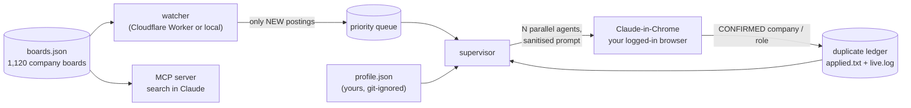

<p align="center">
  
</p>

<h1 align="center">open job copilot</h1>

<p align="center">
  <b>Find the newest jobs first, and let your own AI agent apply for you, honestly.</b><br>
  Free, open source, no API keys, no scraping of login-walled sites.
</p>

<p align="center">
  <a href="https://github.com/LdwS123/open-job-copilot/actions/workflows/ci.yml"></a>
  
  
  
</p>

---

It reads the *public* careers APIs that companies publish themselves (Ashby, Greenhouse, Lever), including a lot of
YC and a16z-backed startups, then helps you search, get alerted the minute a role opens, and, if you choose, apply
with a Claude-in-Chrome agent running **in your own browser**.

## How it fits together



| Part | What it does | Cost |
|---|---|---|
| [`mcp-server/`](mcp-server) | **MCP server.** Ask Claude *"junior sales roles in Europe at YC startups"* and get live postings with apply links | free |
| [`worker/`](worker) | **Cloudflare Worker.** Watches ~1,100 boards 24/7 and queues *new* postings the minute they appear | free plan |
| [`runner/`](runner) | Watcher + supervisor that keep Claude-in-Chrome agents applying nonstop, newest postings first, **never twice to the same company** | your Claude plan |
| [`boards.json`](boards.json) | The curated board list (`ats` + `slug`). PRs welcome | n/a |

> New here? [FRIENDS.md](FRIENDS.md) is the 5-minute setup with an onboarding agent.

## Quick start: search with Claude (2 minutes)

```bash
git clone https://github.com/LdwS123/open-job-copilot && cd open-job-copilot/mcp-server && npm install
claude mcp add job-copilot -- node "$(pwd)/index.js"
```

Any other MCP client:

```json
{ "mcpServers": { "job-copilot": { "command": "node", "args": ["/abs/path/open-job-copilot/mcp-server/index.js"] } } }
```

Tools: `search_jobs`, `get_company_jobs`, `discover_board`, `list_boards`. Try:

- *"Search jobs: keywords sales, exclude senior/director, location paris france europe emea."*
- *"Remote-only growth or community roles at the companies in your list, newest first."*
- *"Does the company `linear` have a public board? Which ATS?"*

## Grow the company list (YC, a16z, anything)

```bash
echo "ramp linear posthog mercor" | python3 runner/discover_boards.py --write
```

Feed it slugs from [ycombinator.com/companies?isHiring=true](https://www.ycombinator.com/companies?isHiring=true)
or [a16z.com/portfolio](https://a16z.com/portfolio). It probes Ashby / Greenhouse / Lever and merges hits into
`boards.json` (then copy it to `mcp-server/` and regenerate `worker/src/boards.js`).

## Be first: the 24/7 watcher

One `wrangler deploy` on Cloudflare's free plan, see [`worker/README.md`](worker/README.md).
Or run it locally: `cp runner/config.example.json runner/config.json && python3 runner/watcher.py`.

## Let an agent apply for you (optional, read the limits)

```bash
cp profile.example.json profile.json        # your real, truthful data (git-ignored)
cd runner && cp config.example.json config.json
./run_all.sh                                # watcher + supervisor (needs the `claude` CLI + Chrome extension)
touch STOP                                  # graceful stop
```

What the supervisor does for you ([details](runner/README.md)):

- keeps `MAXPAR` agents running **nonstop** and survives the 5-hour plan limit (detects it, sleeps, resumes)
- builds every prompt from your profile, the rules in [`runner/rules/`](runner/rules) and a rotating focus
  (startups, DACH, South Europe, AI labs, fast direct-apply sweeps...)
- keeps a **duplicate ledger**, so one company gets one application, even across restarts
- feeds a **freshness-ordered queue**: postings under 24h first, then 48h
- writes a readable `live.log` and never logs the text typed into forms

**Guardrails baked into the prompt** ([`prompt_template.md`](runner/prompt_template.md)): truth only, your real
work-authorization answers, no account creation, no captcha solving, no marketing opt-ins, one application per
company, and only *confirmed* submissions are counted.

### Honest limits

- Applying runs in *your* browser with *your* sessions. It is bounded by your AI plan's usage limits, not by CPU.
  More parallel agents burn quota faster, they don't multiply results.
- Many forms (captcha, account wall, custom widgets) can't be completed automatically; the agent skips and reports.
- Volume is not a strategy by itself. The runner's [`ats_tailoring.md`](runner/rules/ats_tailoring.md) rule makes every agent mirror each posting's title, keywords and location in a truthful, per-offer resume. Tailor your profile, apply where you truly fit, answer recruiters fast.
- Respect each site's terms and rate limits. This project only reads public JSON endpoints.

### Security model

Posting titles, locations and URLs come from third-party boards, so they are treated as hostile input
([`runner/sanitize.py`](runner/sanitize.py), covered by [tests](tests)): URLs must match a strict shape *and* an ATS
host allowlist, text is Unicode-normalised and reduced to a safe character set, queue content is fenced in
`<untrusted_queue>` and the agent is told never to follow instructions found in it. Logs are owner-only. For extra
safety, run the agents in a dedicated Chrome profile with no other sensitive logins. Found a hole?
See [SECURITY.md](SECURITY.md).

## Develop

```bash
(cd mcp-server && npm install && npm test)
python3 -m unittest discover -s tests -v
```

Contributions welcome, especially new boards and ATS adapters: [CONTRIBUTING.md](CONTRIBUTING.md).

## Privacy

`profile.json`, `config.json`, `queue.json`, CVs, logs and tokens are git-ignored. Never commit personal data.

## License

MIT
